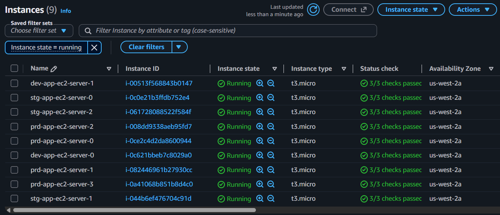
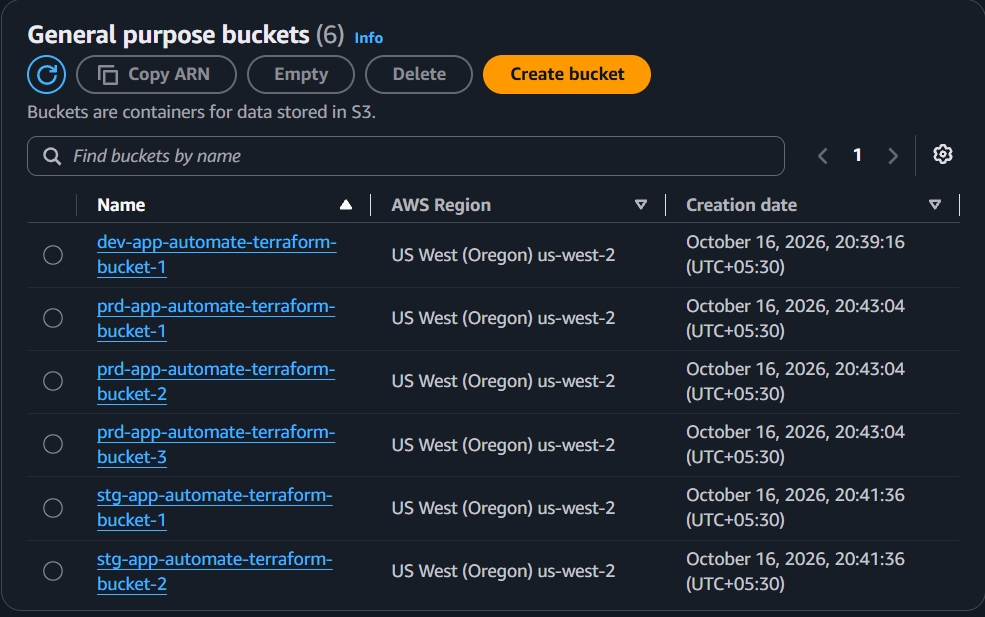
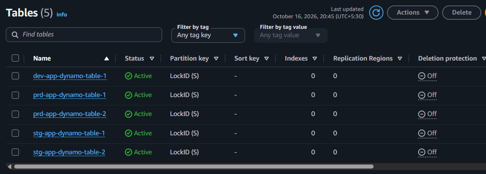
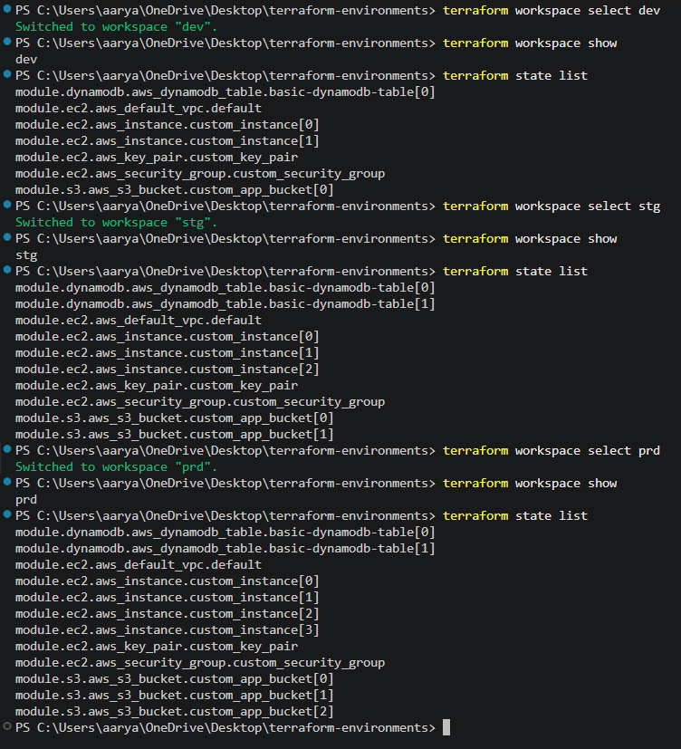
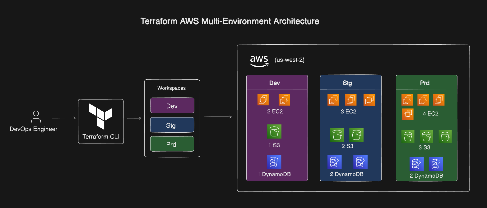

# Terraform Multi-Environment AWS Infrastructure

Infrastructure as Code for provisioning isolated development, staging, and production environments on AWS with Terraform workspaces.

The project creates environment-specific EC2 instances, S3 buckets, and DynamoDB tables from reusable Terraform modules. Resource quantities are selected automatically from the active workspace.


## Provisioned AWS resources

#### EC2 instances



#### S3 buckets



#### DynamoDB tables



### Terraform workspaces



### Architecture




## Technology stack

| Technology | Purpose |
| --- | --- |
| [Terraform](https://developer.hashicorp.com/terraform/docs) | Infrastructure provisioning and environment lifecycle management |
| [Amazon Web Services](https://aws.amazon.com/) | Cloud infrastructure provider |
| [Amazon EC2](https://aws.amazon.com/ec2/) | Compute instances for application workloads |
| [Amazon S3](https://aws.amazon.com/s3/) | Object storage buckets |
| [Amazon DynamoDB](https://aws.amazon.com/dynamodb/) | Serverless NoSQL tables |
| AWS provider `6.68.0` | Terraform integration with AWS |
| AWS Region `us-west-2` | Default deployment region |

## Architecture

The root Terraform configuration selects a deployment profile from the active workspace and passes the profile values to three local modules:

```text
Terraform workspace
        |
        v
Root configuration (main.tf)
        |
        +--> custom_infra/ec2       --> EC2 instances
        |                              Default VPC
        |                              Security group
        |                              Key pair
        |
        +--> custom_infra/s3        --> S3 buckets
        |
        +--> custom_infra/dynamodb  --> DynamoDB tables
```

Each resource is tagged with its environment name. The EC2 module also creates an environment-specific key pair, security group, and EC2 instances in the AWS default VPC.

## Environment profiles

The resource counts are defined in [`main.tf`](./main.tf):

| Workspace | EC2 instances | S3 buckets | DynamoDB tables |
| --- | ---: | ---: | ---: |
| `dev` | 2 | 1 | 1 |
| `stg` | 3 | 2 | 2 |
| `prd` | 4 | 3 | 2 |

The current EC2 configuration uses:

- AMI: `ami-02167eae61967e403`
- Instance type: `t3.micro`
- Root volume: 15 GB `gp3`
- Region: `us-west-2`

> AMI IDs are region-specific. Update the AMI before deploying to another AWS region or when the selected AMI is no longer available.

## Repository structure

```text
.
├── main.tf                         # Workspace profiles and root module calls
├── providers.tf                    # AWS provider configuration
├── terraform.tf                   # Terraform and provider version constraints
├── custom_infra/
│   ├── ec2/
│   │   ├── main.tf                # Key pair, security group, and EC2 instances
│   │   ├── variables.tf
│   │   └── outputs.tf
│   ├── s3/
│   │   ├── main.tf                # S3 buckets
│   │   ├── variables.tf
│   │   └── outputs.tf
│   └── dynamodb/
│       ├── main.tf                # DynamoDB tables
│       ├── variables.tf
│       └── outputs.tf
└── docs/
    └── screenshots/               # Optional README screenshots
```

## Prerequisites

Install and configure the following before running Terraform:

1. [Terraform](https://developer.hashicorp.com/terraform/install) compatible with the project configuration.
2. An AWS account with permission to create EC2, S3, DynamoDB, VPC security group, and EC2 key-pair resources.
3. The [AWS CLI](https://docs.aws.amazon.com/cli/latest/userguide/getting-started-install.html), configured with credentials for the target account.
4. A public SSH key at `custom_infra/ec2/terra-automate-key.pub`.

Verify the AWS identity before provisioning:

```bash
aws sts get-caller-identity
```

Terraform can use the standard AWS credential chain, including an AWS CLI profile or environment variables:

```bash
aws configure
```

Do not commit access keys, private keys, `.tfvars` files, or Terraform state files.

## Getting started

Run the following commands from the repository root.

### 1. Initialize Terraform

```bash
terraform init
```

### 2. Validate and format the configuration

```bash
terraform fmt -recursive
terraform validate
```

### 3. Select an environment workspace

List existing workspaces:

```bash
terraform workspace list
```

Create and select a workspace when it does not already exist:

```bash
terraform workspace new dev
```

Switch between environments with:

```bash
terraform workspace select dev
terraform workspace select stg
terraform workspace select prd
```

The workspace name must match one of the profiles defined in `local.environments` in [`main.tf`](./main.tf).

### 4. Review the plan

```bash
terraform plan
```

The current configuration does not require a variable file. The environment is derived from the selected Terraform workspace.

### 5. Apply the infrastructure

```bash
terraform apply
```

Review the proposed changes and enter `yes` when prompted. For automated environments, use an approved plan file rather than applying an unreviewed plan:


### 6. Inspect and destroy an environment

```bash
terraform show
terraform state list
terraform destroy
```

`terraform destroy` affects only the currently selected workspace. Confirm the active workspace before using it:

```bash
terraform workspace show
```

## Security and operational considerations

This repository is suitable as a learning or starter environment configuration. Review these settings before using it for production workloads:

- The EC2 security group currently permits SSH (`22`) and HTTP (`80`) from `0.0.0.0/0`. Restrict ingress to trusted CIDR ranges or a controlled access path.
- The EC2 module uses the AWS default VPC. Production deployments should normally use a purpose-built VPC with private subnets, routing, and network controls.
- The AMI, instance type, disk size, and region are hard-coded in the root configuration. Consider making them validated variables for reusable deployments.
- S3 buckets do not currently configure versioning, encryption, public-access-block settings, or lifecycle rules. Add these controls for production data.
- DynamoDB tables use on-demand billing and a `LockID` string partition key. Confirm that the schema and backup requirements match the workload.
- Terraform state can contain sensitive infrastructure details. Store it securely, use a remote encrypted backend with locking for team workflows, and never commit state files.
- The EC2 public key is referenced by the module. Keep the corresponding private key outside source control and rotate keys according to your access policy.

## Troubleshooting

### Workspace profile lookup errors

Make sure the active workspace is exactly `dev`, `stg`, or `prd`:

```bash
terraform workspace show
terraform workspace select dev
```

### EC2 key-pair errors

Confirm that this file exists before running `terraform plan`:

```text
custom_infra/ec2/terra-automate-key.pub
```

The public key must be valid OpenSSH public-key content, and the private key should be stored securely outside the repository.

### Resource name conflicts

S3 bucket names are globally unique. If an existing bucket has the same generated name, change the naming convention in `custom_infra/s3/main.tf` or choose a globally unique suffix.

### AWS permission or quota errors

Verify the active AWS identity, region, service quotas, and IAM permissions:

```bash
aws sts get-caller-identity
terraform providers
```

---


<p align="center">
        <b>Learn. Apply. Build.</b>
</p>